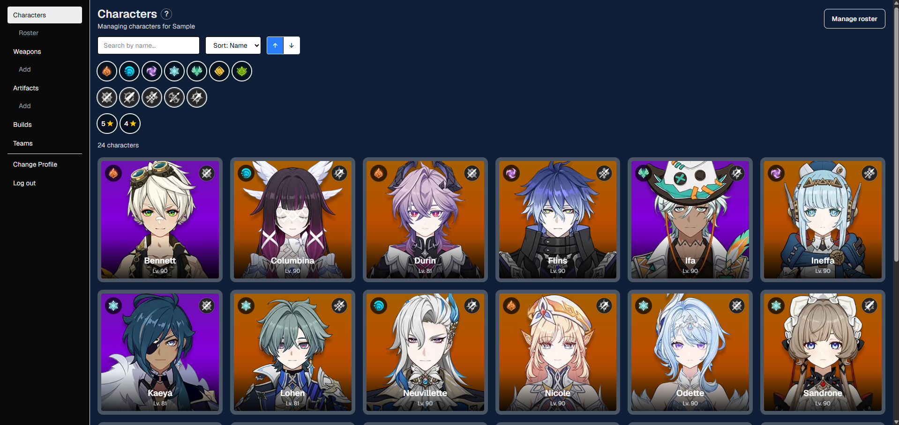
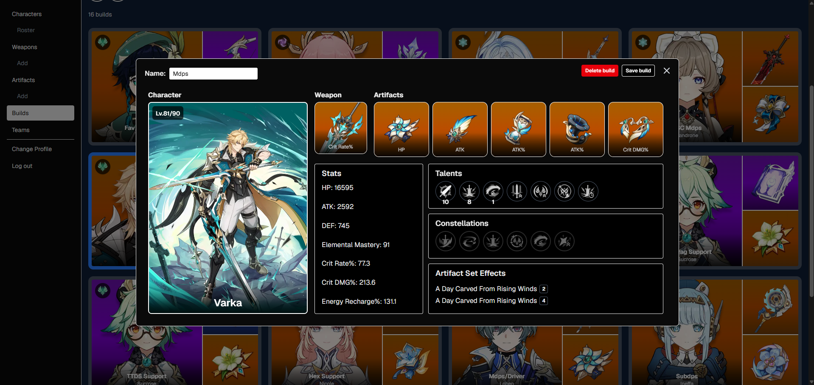
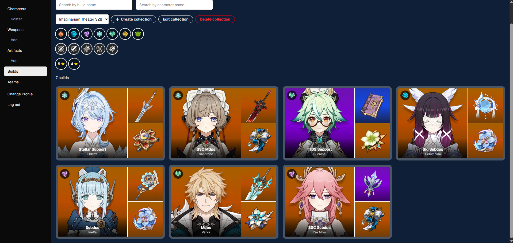
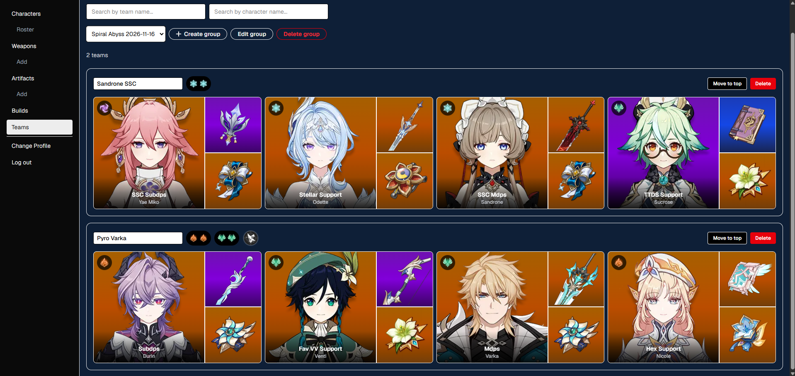
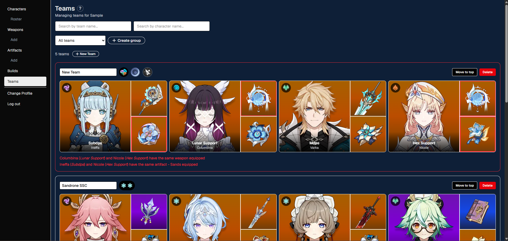

# Genshin Impact Build Planner

A full-stack web app for tracking owned Genshin Impact characters, weapons, and
artifacts, assembling builds and teams, and catching conflicts (shared
weapons/artifacts, duplicate characters).

The game Genshin Impact has no built-in feature to save a character build, so switching a
character between roles —e.g. a DPS set for one team, a support set for another —
means re-equipping its artifacts from memory every time, which gets tedious
fast for any player who keeps multiple builds per character. This project aims to 
solve this problem by allowing users to replicate their game data and create builds
for characters, which can be referenced by the user to equip the correct weapons/artifacts.
Additionally, users can form teams from their created builds and verify that there
are no overlapping characters/weapons/artifacts in the team. 

**Live demo:** https://genshin-impact-build-planner.vercel.app

Demo account (pre-filled with a sample profile — characters, weapons,
artifacts, builds, teams, and a group already set up):

- **Email:** `demo@example.com`
- **Password:** `Demo2026!`

> Unofficial fan project. Not affiliated with or endorsed by HoYoverse.
>
> Built to get hands-on with React/Next.js.

## Features

- **Owned inventory** — track every character, weapon, and artifact you own,
  with full level/ascension/refinement/substat detail
- **Builds** — pair an owned character with a weapon and up to 5 artifacts,
  see computed final stats
- **Collections** — save a combination of builds with conflict detection, useful 
  for planning builds for Imaginarium Theater runs
- **Teams** — assemble up to 4 builds per team with conflict detection while 
  you pick
- **Groups** — save a combination of teams meant to be run together, meant for 
  Spiral Abyss and Stygian Onslaught 

## Screenshots

| Owned characters | Build editor |
| --- | --- |
|  |  |

| Collections | Groups |
| --- | --- |
|  |  |

| Team assembly (conflict detection) |
| --- |
|  |

## Roadmap

Ideas I may get to if time permits:

- **Per-content validation rules** — e.g. Imaginarium Theater's seasonal
  3-element and guest-character restrictions, enforced automatically on a Collection
- **Home page dashboard** — an at-a-glance task/reminder list instead of
  landing straight on Characters
- **Support for other games with a similar build system** — e.g. Honkai: Star
  Rail, Zenless Zone Zero, Wuthering Waves

## Tech stack

- **Next.js** (App Router, Server Components/Actions) + **React** + **TypeScript**
- **PostgreSQL** (hosted on [Neon](https://neon.tech)) via **Prisma ORM**
- **Tailwind CSS v4**
- **Vitest** for unit tests
- Deployed on **Vercel**

## Getting started

```bash
git clone https://github.com/Vision-2000/Genshin-Impact-Build-Planner.git
cd Genshin-Impact-Build-Planner
npm install
cp .env.example .env   # fill in your own DATABASE_URL (e.g. a free Neon project)
npx prisma migrate dev
npx prisma db seed     # imports the master data into your db
npm run dev
```

Then open [http://localhost:3000](http://localhost:3000) and create an account.

### Scripts

| Command                 | Description                                  |
| ------------------------ | --------------------------------------------- |
| `npm run dev`            | Start the dev server                          |
| `npm run build`          | Production build                              |
| `npm test`               | Run the test suite (Vitest)                   |
| `npm run lint`           | Lint the codebase (ESLint)                    |
| `npx tsc --noEmit`       | Type-check without emitting output            |

## Notable implementation details

- **`src/lib/overlap.ts`** — one generic conflict-detection function shared
  across Teams, Groups, and Collections, rather than reimplementing
  duplicate-character/shared-weapon/shared-artifact checks per screen.
- **Master vs. owned data split** — `Character`/`Weapon`/`ArtifactSet` are
  static, shared reference data seeded once from hand-maintained JSON
  (`data-source/`); `OwnedCharacter`/`OwnedWeapon`/`OwnedArtifact` are the
  per-user data that actually changes. Per-level/per-refinement stat and
  talent values are computed on demand from a small set of shared curves
  (`src/lib/character-scaling.ts`, `weapon-scaling.ts`, `talent-scaling.ts`)
  rather than stored as one row per level — see `CLAUDE.md` for the full
  reasoning and the formula reference in `data-source/master-data-formulas.txt`.
- **`prisma/seed.ts`** imports already-classified JSON, with a verification script
  (`data-export/verify-reseed.mts`) confirming every reseed is lossless.

## Credits

This project is unofficial and uses no official HoYoverse API. Game data, images,
and UI inspiration came from:

- [Lunaris](https://lunaris.moe/) and [HoYoWiki](https://wiki.hoyolab.com) — master
  data reference (characters, weapons, artifact sets)
- [Genshin Impact Wiki (Fandom)](https://genshin-impact.fandom.com) — stat/formula
  reference, including the full attribute list
- [Enka.Network](https://enka.network) — character, weapon, and artifact icon images,
  and inspiration for character builds UI
- [Prydwen](https://www.prydwen.gg/genshin-impact/) — layout reference for the sidebar
  navigation and card-grid pages
